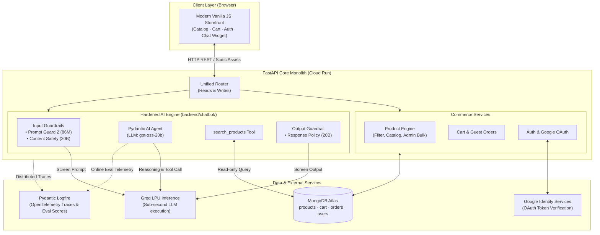
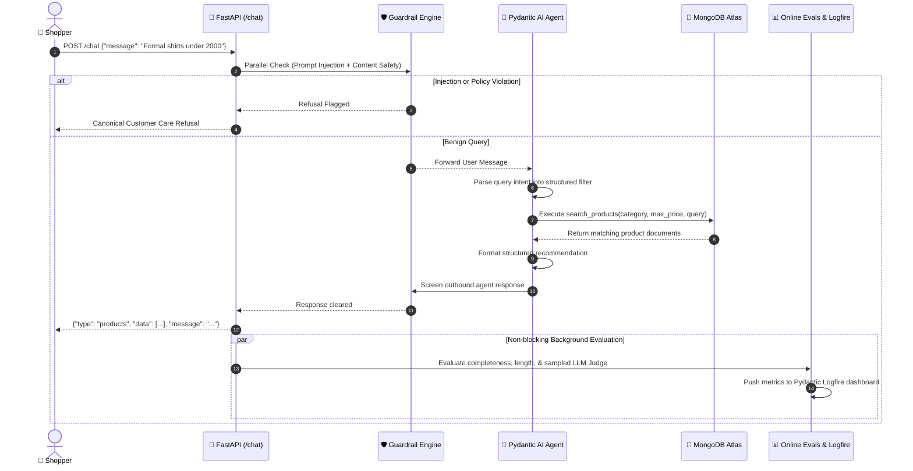

# 👕 UrbanVault — Enterprise AI E-Commerce Storefront

[](https://www.python.org/)
[](https://fastapi.tiangolo.com/)
[](https://ai.pydantic.dev/)
[](https://groq.com/)
[](https://www.mongodb.com/atlas)
[](https://cloud.google.com/run)
[](https://logfire.pydantic.dev/)
[](LICENSE)

An enterprise-ready, full-stack e-commerce platform paired with an in-context **AI Shopping Assistant**. Built with a zero-build vanilla JavaScript storefront, a high-throughput FastAPI backend, MongoDB Atlas, and a hardened Pydantic AI agent running high-speed inference on Groq with multi-tier guardrails, continuous live evals, and full OpenTelemetry distributed tracing.

---

## 🧭 Executive Summary & FDE Engagement Context

In modern enterprise AI delivery, a **Forward Deployed Engineer (FDE)** bridges the gap between high-level client business objectives and production-hardened engineering. Rather than treating AI as an isolated research demo, an FDE discovers real client constraints, creates an isolated Proof-of-Concept (POC) against live customer schemas, and integrates the hardened capability directly into the core production architecture with rigorous guardrails, evals, and observability.

### The Delivery Lifecycle across Repository Branches

This repository demonstrates the complete FDE lifecycle across three git branches:

```
┌─────────────────────────────────┐
│  01-store-only (Discovery)      │  Client baseline: FastAPI + MongoDB + Storefront
└───────────────┬─────────────────┘  No AI dependencies. Complete e-commerce features.
                │
                ▼
┌─────────────────────────────────┐
│  02-chatbot-poc (POC)           │  Isolated validation: Standalone Pydantic AI agent
└───────────────┬─────────────────┘  `POST /chat` + DB tool access + dual guardrails.
                │
                ▼
┌─────────────────────────────────┐
│  main (Production Integration)  │  Hardened monolith: Merged core + AI pipeline,
└─────────────────────────────────┘  online/offline evals, Logfire traces, GCP CI/CD.
```

| Branch | Stage | Scope & Deliverables |
|:-------|:------|:---------------------|
| [`01-store-only`](../../tree/01-store-only) | **Discovery** | The client's baseline apparel platform: FastAPI monolith, MongoDB Atlas schema (`products`, `cart`, `orders`, `users`), guest & Google OAuth, cart & checkout, admin panel. **Zero AI footprint.** |
| [`02-chatbot-poc`](../../tree/02-chatbot-poc) | **Proof of Concept (POC)** | Isolated capability demonstration: Pydantic AI agent executing `search_products` queries against live catalog collections, shielded by initial safety guardrails via Groq LPUs. Packaged as a clean, modular drop-in package. |
| **`main`** *(You are here)* | **Production Integration** | Production deployment: Merged storefront + AI service, automated unique indexing, dual-stage input/output safety models, offline eval suite (`pydantic-evals`), streaming online evals, Logfire distributed tracing, and automated Google Cloud Run CI/CD. |

> Detailed narrative and architectural decisions are documented in [`docs/STORY.md`](docs/STORY.md) and [`INTEGRATION.md`](INTEGRATION.md).

---

## 🏗️ System Architecture

UrbanVault is deployed as a single, containerized FastAPI application hosting both the static storefront and REST endpoints, communicating directly with MongoDB Atlas, Groq LLM inference, and Pydantic Logfire telemetry.



### End-to-End Chat Pipeline Execution Flow

When a shopper sends a prompt via the conversational interface, the request executes through a fail-open, guarded pipeline ([`backend/chatbot/pipeline.py`](backend/chatbot/pipeline.py)):



---

## 🛡️ Enterprise AI Safety, Guardrails & Fallbacks

1. **Dual-Model Input Screening**:
   - **Prompt Injection Defense**: Evaluated via `meta-llama/llama-prompt-guard-2-86m` to intercept jailbreaks, system prompt exfiltration, and adversarial delimiters before hitting the agent.
   - **Content Safety Policy**: Evaluated via `openai/gpt-oss-safeguard-20b` to block toxicity, illicit activity, and brand-damaging queries.
2. **Output Screening**: Outbound assistant answers pass through a safety classifier to ensure responses remain strictly within customer care and shopping domain boundaries.
3. **Fail-Open Resilience**: If Groq's guardrail endpoint experiences transient network timeouts or errors, the failure is logged to Logfire and the user request proceeds safely rather than breaking the chat experience.
4. **Canonical Support Fallback**: Any refusal or unhandled agent error outputs a standard corporate fallback:
   > *"Sorry, I can't help with that. For assistance, contact our customer care at 546464434."*
5. **Hallucination Prevention**: The agent cannot invent products, prices, or inventory. It is strictly constrained to the catalog items returned by MongoDB via `search_products`.

---

## 📊 Observability & Continuous Evaluation

Production AI applications require continuous verification against regressions and drift. UrbanVault implements both **offline batch validation** and **real-time online evaluation**:

### 1. Offline Regression Suite (`pydantic-evals`)
Run on demand or inside CI/CD pipelines to validate model performance across curated test cases:
- **Tool Call Execution**: Verified via OpenTelemetry span inspection (`HasMatchingSpan`), ensuring the agent actually invokes `search_products` rather than hallucinating answers.
- **Intent Routing**: Verifies greetings receive polite text while product inquiries trigger database searches.
- **Adversarial Resilience**: Confirms prompt injections and policy violations trigger immediate refusal blocks.
- **Semantic Quality**: Graded using an LLM Judge (`openai/gpt-oss-120b`).

```bash
# Execute the offline evaluation dataset
python -m backend.evals.chatbot_evals
```

### 2. Live Online Monitoring
Configured in [`backend/chatbot/online_evals.py`](backend/chatbot/online_evals.py) via `OnlineEvaluation`:
- **`ReplyNotEmpty`**: Detects empty or silent token generation failures.
- **`ReplyLength`**: Tracks response length distributions over time to flag anomalies.
- **Sampled LLM Quality Judge**: Evaluates 30% of live traffic against corporate brand tone and factual accuracy without exhausting API rate limits.
- **Live Dashboards**: All scores and full OpenTelemetry execution traces stream directly into **Pydantic Logfire**.

---

## ⚡ Tech Stack

| Layer | Technology | Rationale & Selection Criteria |
|:------|:-----------|:-------------------------------|
| **Storefront** | Vanilla HTML5, CSS3, ES Modules | Zero-build, instant deployment, no JavaScript bundler overhead, highly inspectable. |
| **Backend API** | FastAPI (Python 3.11+) | Asynchronous high concurrency, native OpenAPI docs (`/docs`), seamless Pydantic validation. |
| **Database** | MongoDB Atlas | Flexible JSON schema for dynamic product attributes (sizes, colours, categories). |
| **AI Agent** | Pydantic AI | Robust tool-calling, type safety, structured outputs, first-class OpenTelemetry integration. |
| **Model Inference** | Groq LPU | Ultra-low-latency token generation for real-time conversational shopping experiences. |
| **Guardrail Models** | Llama Prompt Guard 2 + GPT-OSS Safeguard | Specialized small models for sub-100ms deterministic safety filtering. |
| **Observability** | Pydantic Logfire | Distributed tracing across FastAPI, Pydantic, and Pydantic AI agent executions. |
| **Cloud Hosting** | Google Cloud Run | Serverless autoscaling (scales to zero), container-native, automatic HTTPS. |
| **CI/CD & Secrets** | Cloud Build + Secret Manager | Automated Docker builds, zero-secret-in-code deployments, Artifact Registry storage. |

---

## 🚀 Quickstart & Local Setup

### Prerequisites
- **Python 3.11+** installed
- **MongoDB Atlas** database connection URI
- **Groq API Key** (from [console.groq.com](https://console.groq.com/))
- *(Optional)* **Logfire Write Token** (from [logfire.pydantic.dev](https://logfire.pydantic.dev/))
- *(Optional)* **Google Client ID** for Google Sign-In

### 1. Clone & Configure Environment

```bash
# Clone repository
git clone https://github.com/Manishthakur99/Ecommerce-store-gcp.git
cd Ecommerce-store-gcp

# Copy environment template
cp .env.example .env
```

Edit `.env` with your credentials:

| Key | Required? | Description |
|:----|:---------:|:------------|
| `MONGO_URI` | **Yes** | MongoDB connection string (e.g. `mongodb+srv://...`) |
| `GROQ_API_KEY` | **Yes** | Groq API token for LLM inference and guardrails |
| `LOGFIRE_API_KEY` / `LOGFIRE_TOKEN` | *Optional* | Pydantic Logfire token for tracing and eval metrics |
| `GOOGLE_CLIENT_ID` | *Optional* | OAuth 2.0 Web Client ID for Google One-Tap / Sign-In |
| `PORTKEY_API_KEY` | *Optional* | API Gateway routing key (leaves empty for direct Groq calls) |

### 2. Install Dependencies

Using [`uv`](https://github.com/astral-sh/uv) (recommended for blazingly fast installs) or standard `pip`:

```bash
# Using uv:
uv venv clothenv
source clothenv/bin/activate        # On Windows: clothenv\Scripts\activate
uv pip install -r requirements.txt

# Or using standard python venv:
python -m venv clothenv
source clothenv/bin/activate        # On Windows: clothenv\Scripts\activate
pip install -r requirements.txt
```

### 3. Initialize & Launch

Start the unified application:

```bash
python main.py
```

- **Storefront**: [http://localhost:8000](http://localhost:8000)
- **Interactive Swagger Docs**: [http://localhost:8000/docs](http://localhost:8000/docs)
- **OpenAPI Schema**: [http://localhost:8000/openapi.json](http://localhost:8000/openapi.json)

> **Startup Lifecycle**: On startup, `ensure_indexes()` automatically verifies and builds unique indexes on the `users` collection in MongoDB to prevent duplicate accounts.

### 4. Seed Catalog Data (Admin Demo)

To populate the catalog with demo products and high-resolution assets:
1. Open [http://localhost:8000](http://localhost:8000) and click **Admin** in the header.
2. Select **Bulk Upload**.
3. Upload [`demo_data/bulk_upload.xlsx`](demo_data/bulk_upload.xlsx) as the spreadsheet.
4. Upload [`demo_data/Imgs.zip`](demo_data/Imgs.zip) as the image bundle.
5. Click **Import** — your catalog is immediately live and searchable via chat.

---

## 📡 API Reference Overview

The FastAPI backend cleanly separates read and write routers across domain boundaries:

| Method | Endpoint | Description |
|:-------|:---------|:------------|
| `POST` | `/chat` | **AI Assistant Endpoint**. Accepts user message, runs guardrails & shopping agent, returns text/product payload. |
| `GET` | `/products` | List catalog items with filtering (`category`, `min_price`, `max_price`, `skip`, `limit`). |
| `GET` | `/products/{id}` | Retrieve individual product metadata, available sizes, and colours. |
| `POST` | `/cart` | Add an item (with selected size and colour) to an email-keyed shopping cart. |
| `GET` | `/cart/{email}` | Retrieve the active cart state for a given shopper. |
| `POST` | `/orders` | Place an order for all items in the cart (supports guest and authenticated users). |
| `GET` | `/orders/{email}` | Query purchase history for an email account. |
| `POST` | `/auth/register` | Register an email/password account (passwords hashed via bcrypt). |
| `POST` | `/auth/login` | Authenticate an existing account. |
| `POST` | `/google-auth` | Verify and authenticate via Google Identity OAuth ID tokens. |
| `POST` | `/products/bulk` | Admin bulk ingestion of Excel catalog metadata and zipped imagery. |

### Chat API Request/Response Schema

**Request:**
```json
POST /chat
{
  "message": "Can you show me white shirts under ₹1500?"
}
```

**Response (Products Matched):**
```json
{
  "type": "products",
  "message": "Here are some white shirts under ₹1500 from our catalog:",
  "data": [
    {
      "id": "673f1a2b...",
      "name": "Classic White Linen Shirt",
      "price": 1299,
      "category": "men",
      "image_url": "/product_images/white_shirt.jpg",
      "colors": ["White"],
      "sizes": ["M", "L", "XL"]
    }
  ]
}
```

---

## ☁️ Google Cloud Production Deployment

UrbanVault is packaged into a minimal Docker container and continuously deployed onto **Google Cloud Run** using **Cloud Build** and **Secret Manager**.

```
[Git Push to main]
       │
       ▼
[Cloud Build Trigger]
       │
       ├─► 1. Build Docker image (`Dockerfile`)
       ├─► 2. Push to Google Artifact Registry (`asia-south1`)
       └─► 3. Deploy to Cloud Run with Secret Manager environment variables
```

### Deployment Configuration Highlights
- **Container**: Multi-stage lightweight Python runtime (`Dockerfile`).
- **Autoscaling**: Scaled on Google Cloud Run with `--cpu-boost`, 1 vCPU, 1 GiB RAM, and 300s execution timeout.
- **Secret Integration**: Sensitive environment variables (`MONGO_URI`, `GROQ_API_KEY`, `LOGFIRE_TOKEN`, `GOOGLE_CLIENT_ID`) are mounted securely from GCP Secret Manager at runtime.
- **Colocated Region**: Deployed in `asia-south1` (Mumbai) alongside MongoDB Atlas to guarantee sub-10ms database roundtrips.

> Step-by-step console setup commands and IAM permissions are provided in [`commands.md`](commands.md) and [`docs/07-deployment.md`](docs/07-deployment.md).

---

## 📂 Project Organization

```
gcp-ecom-store/
├── .env.example              # Environment variables template
├── Dockerfile                # Production container specification
├── cloudbuild.yaml           # Google Cloud Build CI/CD deployment pipeline
├── commands.md               # Complete GCP setup & deployment runbook
├── main.py                   # Application entrypoint (FastAPI monolith)
├── requirements.txt          # Python dependencies
│
├── backend/                  # Application core
│   ├── auth.py               # Password hashing & JWT helpers
│   ├── config.py             # Pydantic Settings & environment validation
│   ├── database.py           # MongoDB connection & index creation
│   ├── models.py             # Pydantic schemas (Product, Cart, Order, User)
│   ├── chatbot/              # Hardened AI shopping assistant package
│   │   ├── agent.py          # Pydantic AI agent & `search_products` tool
│   │   ├── guardrails.py     # Prompt-injection & safety classifiers
│   │   ├── pipeline.py       # Fail-open chat orchestrator
│   │   └── online_evals.py   # Live background evaluation capabilities
│   ├── evals/                # Offline evaluation suite
│   │   └── chatbot_evals.py  # Batch eval dataset & LLM Judge suite
│   ├── routes/               # FastAPI modular route handlers
│   │   ├── auth.py           # Email/password authentication
│   │   ├── cart.py           # Cart read/write operations
│   │   ├── chatbot.py        # POST /chat endpoint
│   │   ├── google_auth.py    # Google OAuth ID token verification
│   │   ├── orders.py         # Order placement & history
│   │   ├── products.py       # Catalog query endpoints
│   │   ├── products_bulk.py  # Bulk Excel/Zip importer
│   │   └── profile.py        # User profile & avatar management
│   └── utils/                # Helper utilities (image processing, excel)
│
├── Frontend/                 # Vanilla JS zero-build storefront
│   ├── index.html            # Main SPA entrypoint
│   ├── css/                  # Styling & responsive design
│   ├── js/                   # Core frontend application logic
│   └── src/                  # State management & client API bindings
│
├── demo_data/                # Sample catalog dataset for demonstration
│   ├── bulk_upload.xlsx      # Sample product spreadsheet
│   └── Imgs.zip              # Catalog images bundle
│
├── docs/                     # Comprehensive engineering documentation
│   ├── STORY.md              # FDE delivery story (01 -> 02 -> main)
│   ├── 01-overview.md        # Solution overview & business goals
│   ├── 02-architecture.md    # In-depth architectural decomposition
│   ├── 03-frontend.md        # Storefront state & routing mechanics
│   ├── 04-backend.md         # API route breakdown & database interactions
│   ├── 05-database.md        # MongoDB schema design & indexes
│   ├── 06-ai-assistant.md    # Agent pipeline, guardrails & evals
│   ├── 07-deployment.md      # Google Cloud deployment guide
│   └── 08-glossary.md        # Technical terminology index
│
└── Client reports/           # Executive handover deliverables
    ├── UrbanVault-AI-Assistant-Presentation.pptx   # Executive deck
    └── UrbanVault-AI-Assistant-Technical-Design.docx # Technical design doc
```

---

## 📑 Documentation & Handover Assets

For deep dives into individual layers, consult the targeted documentation:
- 📖 [**Story of the Engagement**](docs/STORY.md) — How the three git branches reflect discovery, POC, and production.
- 📐 [**System Architecture**](docs/02-architecture.md) — Detailed request walkthroughs, read/write router segregation.
- 🧠 [**AI Assistant & Safety**](docs/06-ai-assistant.md) — Deep dive into Pydantic AI, tool definition, and safety policies.
- ☁️ [**Cloud Deployment Guide**](docs/07-deployment.md) — Cloud Run, Artifact Registry, and Cloud Build setup.
- 💼 [**Client Presentation Deck**](Client%20reports/UrbanVault-AI-Assistant-Presentation.pptx) — Stakeholder overview presentation.
- 📄 [**Client Technical Design Document**](Client%20reports/UrbanVault-AI-Assistant-Technical-Design.docx) — Formal enterprise architecture specification.

---

## 📄 License

This project is licensed under the [MIT License](LICENSE).
